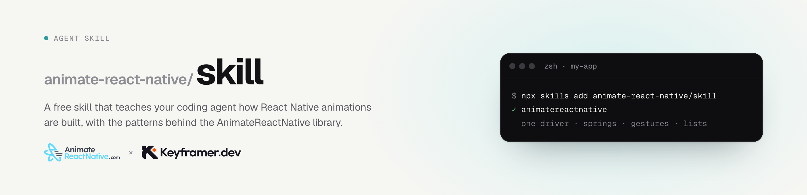

<picture>
  <source media="(prefers-color-scheme: dark)" srcset="https://raw.githubusercontent.com/animate-react-native/skill/main/docs/banner-dark.png">
  
</picture>

# AnimateReactNative skill

A free skill that teaches your coding agent how React Native animations are built, with the patterns behind the [AnimateReactNative](https://www.animatereactnative.com) library. It works with Claude Code, Cursor, Codex and any other agent that reads skills.

```sh
npx skills add animate-react-native/skill
```

Then ask in plain language: "make the cards scale while I scroll", "make it bouncy", "it's janky on Android".

## What the agent learns

- One shared value drives the animation. Every animated property is an interpolation of it.
- A gesture hands its velocity to the spring when the finger lifts.
- A list never re-renders while it scrolls.
- How to find the cause of dropped frames, and what to change for each cause.

## What is inside

| File | What it covers |
| --- | --- |
| `SKILL.md` | When to use the skill, the mental model, how a plain request maps to a pattern, the rules |
| `references/core-concepts.md` | One driver, springs, press feedback, stagger, layout animations, text |
| `references/gestures.md` | Follow and release, springs on release, commits, snap points, card decks, sensors |
| `references/scroll-and-lists.md` | Scroll-driven items, pinning, pagination, headers, sheets, marquees, feeds |
| `references/animation-math.md` | Interpolation, trigonometry and rotation, rings, endless motion, loops, noise |
| `references/performance.md` | The frame budget, an audit for dropped frames, wrong and right by cause |

It targets Reanimated version 4 on the New Architecture, and says where Reanimated version 3 differs. Gesture examples use the Gesture Handler version 2 API.

## Patterns, not source

The snippets are the 10 to 20 lines that carry each technique, and each pattern links to the animation it comes from. The complete animations, with their source, are on [animatereactnative.com](https://www.animatereactnative.com/animations). 13 of them are free.

The skill needs no account and no license.
